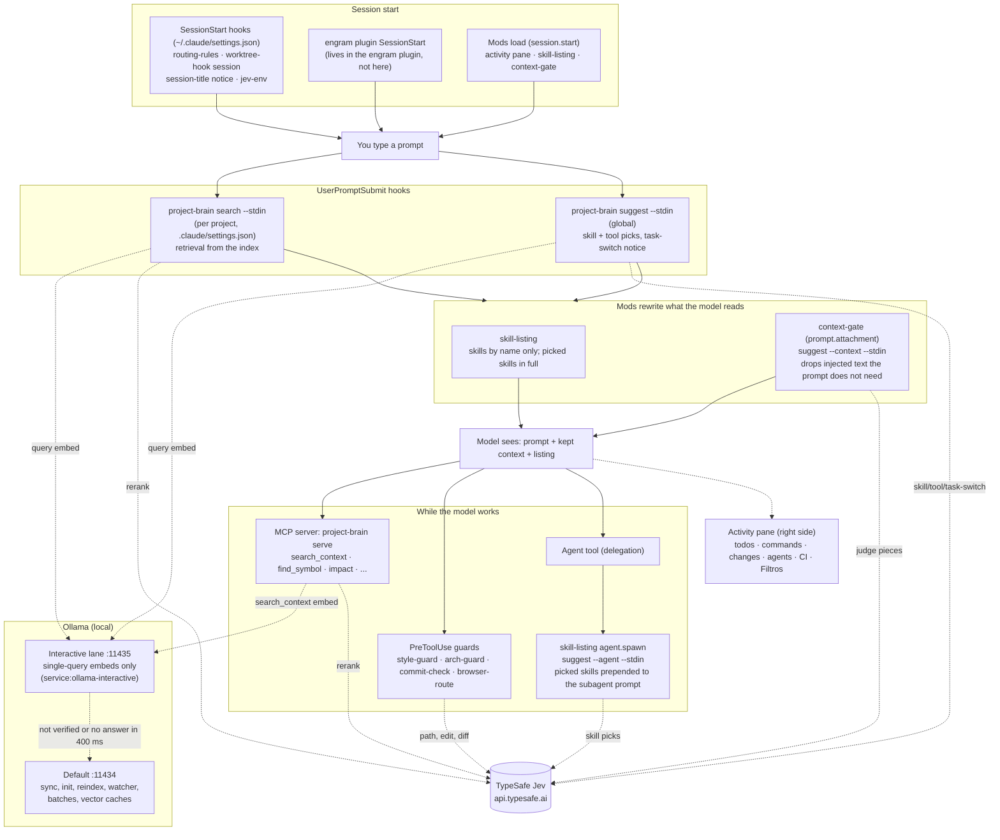

# project-brain flow map

One page for the whole Claude Code flow that project-brain builds around a session: what each piece does, where it lives, how to turn it on or off, what leaves the machine, and what to do when something breaks. It is written for returning to this weeks later, so every path and switch below was checked against the code at `cd582bb`.

## Quick path

When something feels off, these four steps answer most questions:

1. `project-brain health` shows Ollama, the interactive lane (`up`, `down`, `mismatch`, `off`), the index and whether a Jev token resolves.
2. `project-brain setup` lists every unit with its state on disk (`current`, `stale`, `absent`, `foreign`) before it changes anything. Answer "no" at the diff to leave everything as it is.
3. The "Filtros" section of the activity pane shows, for this session, what the context gate dropped, which skills Jev picked, the listing mode and the lane state.
4. If the answer is "a piece is broken", go to [Troubleshooting](#5-troubleshooting).

## 1. The whole flow

From the moment a session starts to the moment the model sees context. Solid arrows are the normal path. Dotted arrows are calls that leave the machine (TypeSafe) or that go to a local service (Ollama).

Three rules hold the flow together:

- **No token, no network.** Every Jev call needs a TypeSafe token (`TYPESAFE_API_KEY` or `~/.project-brain/reranker.json`). Without one, each piece falls back to its local behaviour and prints nothing.
- **Fail open.** A Jev timeout, an error or a slow lane never blocks a prompt, an edit or a spawn. The text goes through unchanged.
- **Queries on the lane, batches on the default.** Only single-query embeds use port 11435, and only after the lane is verified identical to 11434. Indexing never touches the lane.

## 2. Every piece

Defaults are what a first `setup` would tick. "Off" means unticking the unit in `project-brain setup`, or `project-brain setup --without=<unit>`, unless the row says otherwise.

### Session start

| Piece | What it does | Where it lives | Unit | Turn it off | Default |
|---|---|---|---|---|---|
| Routing reminder | Injects the model-routing tier table once per session | `project-brain routing-rules` hook in `~/.claude/settings.json` | `hooks:routing` | Untick; `--no-routing-hook` | on |
| Routing guidance | Tier per task when delegating, loaded as the `brain-model-routing` skill with a one-line pointer in `CLAUDE.md` | `~/.claude/skills/brain-model-routing/`, `~/.claude/CLAUDE.md` | `guidance:model-routing` + `feature:routing-skill` | Untick `feature:routing-skill` to put the full block back inline; untick `guidance:model-routing` to remove both | on |
| Routing overrides | Remaps tiers or adds rules | `~/.project-brain/model-routing.json` | none | Delete the file | absent |
| Worktree identity | Tells the session which worktree and project id it is in; cleans the index on removal | `project-brain worktree-hook session` / `cleanup` hooks | `hooks:worktree` | Untick | on |
| Session title | Names and colours the session after the work | `session-title notice` (SessionStart) and `session-title apply` (Stop) hooks | `hooks:session-title` | Untick | on |
| Token export | Exports the stored Jev token as `TYPESAFE_API_KEY` into the session | `project-brain jev-env` hook | `config:reranker` | Untick (also removes the token) | off |
| engram | Persistent memory protocol | engram plugin (its own marketplace) | none, not project-brain | Disable the plugin | n/a |

### Every prompt

| Piece | What it does | Where it lives | Unit | Turn it off | Default |
|---|---|---|---|---|---|
| Retrieval hook | `project-brain search --stdin` injects up to 5 relevant snippets from this project's index, skipping ones already in the transcript | `<project>/.claude/settings.json`, written by `project-brain init` | none (`init`) | Remove the hook from that file; `PROJECT_BRAIN_SEARCH_PROMPT_FILTER=0` searches every prompt instead | on after `init` |
| Search gating | Skips acknowledgements, slash commands and pasted reports; caps hits; floors reranked scores at 0.5 | `src/hooks/` + `~/.project-brain/features.json` | `feature:search-gate` | Untick | on |
| Skill and tool suggestions | `project-brain suggest --stdin`: Jev picks skills (70% floor, at most 10) and one MCP tool per prompt | global `UserPromptSubmit` hook in `~/.claude/settings.json`; config in `~/.project-brain/skills.json` | `hooks:suggest` | Untick (a marker in `suggest-hook.json` keeps it from returning); `BRAIN_SKILL_PICKER=0`, `BRAIN_TOOL_PICKER=0`, or `"picker": false` | on (silent without a token) |
| Task-switch notice | One-line `/clear` or `/compact` hint once the context is over 30% full | rides the suggest hook | `feature:task-switch` | Untick; `PROJECT_BRAIN_TASK_SWITCH=0` | on |
| Reranker | Jev reorders `search_context` and hook results | `src/rerank/`; token in `~/.project-brain/reranker.json` | `config:reranker` | Untick | off |

### Mods (Claude Code plugins in a local marketplace)

All three are written to `~/.project-brain/claude-plugins/` and registered in `~/.claude/settings.json` under `extraKnownMarketplaces["project-brain"]` and `enabledPlugins["<mod>@project-brain"]`. Sources live in `templates/claude-tui/<mod>/`. They need Claude Code 2.1.287 or later and do not load when `disableAllHooks` is set.

| Piece | What it does | Where it lives | Unit | Turn it off | Default |
|---|---|---|---|---|---|
| Activity pane | Right pane: todos, commands, uncommitted changes with diffs, subagents, CI runs (`gh`), blocked items, Filtros savings; `/activity` reopens it. Sets `tui` to `fullscreen` | `project-brain-activity` mod; `templates/claude-tui/activity-pane/` | `tui:activity-pane` | Untick (restores your previous `tui` from `previous-tui.json`) | on |
| Compact skill listing | Lists skills by name only; general-use skills keep their description. With Jev, the suggest hook brings picked skills in full; without it, the 15 most used keep theirs | `project-brain-skill-listing` mod; `~/.project-brain/skills.json`, `skill-usage.json` | `tui:skill-listing` | Untick; `BRAIN_SKILL_PICKER=0` falls back to usage mode | off |
| Context gate | Before injected hook text reaches the model, Jev scores each piece against the prompt; under 0.5 is dropped and logged. engram, project-brain and `contextAllow` signatures are never filtered | `project-brain-context-gate` mod; log in `~/.project-brain/context-gate-log.json` | `tui:context-gate` | Untick; `BRAIN_CONTEXT_GATE=0`; `"contextGate": false` in `skills.json` | off |
| Readable replies | Marked block in `~/.claude/CLAUDE.md`: result first, evidence last | `~/.claude/CLAUDE.md` | `tui:readable-replies` | Untick (deletes only the block) | on |

### Delegation

| Piece | What it does | Where it lives | Unit | Turn it off | Default |
|---|---|---|---|---|---|
| Subagent skill picks | On every Agent spawn, `suggest --agent --stdin` picks skills for the task and prepends them to the subagent prompt; that subagent then gets a names-only listing | skill-listing mod (`agent.spawn`) | `tui:skill-listing` | Untick; `BRAIN_SKILL_PICKER=0` | off |
| Strict routing guard | Blocks a spawn that names no model | `project-brain routing-guard` PreToolUse hook | `hooks:routing` with `--routing-hook-strict` | Run setup without the flag | off |
| Coding rules guard | First code edit by any agent (session or subagent) injects the `brain-style` skill | `project-brain style-guard` PreToolUse hook | `hooks:style-guard` | Untick | on |
| Subagent report contract | Asks every delegation for a verdict-first report: Verdict (PASS, BLOCKERS, PARTIAL, DONE), Changes, Tests (counts), Risks, Needs a decision; about 400 words, full detail in a file whose path goes in the report. The text is in the `brain-model-routing` skill (routing content version 6) and the SessionStart reminder. The opt-in hook appends it to each `Task` or `Agent` prompt through `updatedInput`, unless the prompt already carries it or sets its own output format | `src/rules/report-contract.ts`; `project-brain report-contract` PreToolUse hook (matcher `Task\|Agent`, `src/hooks/report-contract.ts`) in `~/.claude/settings.json` | `hooks:report-contract` (hook); the skill and reminder text ride `guidance:model-routing` and `hooks:routing` | Untick `hooks:report-contract` | hook off; skill and reminder on |

### Edit and commit guards

| Piece | What it does | Where it lives | Unit | Turn it off | Default |
|---|---|---|---|---|---|
| Architecture guard | Checks added imports against layer rules; with a token, asks Jev about `okf/` constraints | `project-brain arch-guard` hook; `~/.project-brain/architecture.json` or `<project>/.project-brain/architecture.json` | `hooks:arch-guard` | Untick; `"mode": "off"` in a config | on (warn) |
| Commit check | On `git commit`, Jev triages the staged diff for risk and missing tests; local check for new comments | `project-brain commit-check` hook; `~/.project-brain/commit-check.json` for `"mode": "block"` | `hooks:commit-check` | Untick | on only if a token exists |
| Browser route notice | First chrome-devtools call gets one line on which browser to use | `project-brain browser-route` hook | `hooks:browser-route` | Untick | on |
| git post-commit | `sync --changed-only && conceptualize` in the background, output in `.project-brain/sync.log`. `conceptualize` writes each touched module's concept doc with the chosen backend (anthropic, claude-code or ollama); a missing backend (no credentials, no `claude` on PATH, logged out, model not pulled, Ollama unreachable, a timeout) skips the commit's modules with one line. An unknown `BRAIN_CONCEPT_PROVIDER` or a corrupt `concept.json` sends nothing, never falls back to anthropic. One run at a time per machine (`conceptualize.lock`): a rebase's burst of post-commit runs skips all but the first. Each module's diff is cut from the end to fit a 32k-token window; a reply without the five headings is never written | the repository's git `post-commit` hook, written by `init`; backend in `~/.project-brain/concept.json` or `BRAIN_CONCEPT_PROVIDER` | none (`init`); `conceptualize` itself: `feature:conceptualize`; backend: `config:concept-provider` | Remove the hook; untick `feature:conceptualize` (or `PROJECT_BRAIN_CONCEPTUALIZE=0`) to keep the sync and send nothing | on after `init`; backend anthropic |

### Ollama and the index

| Piece | What it does | Where it lives | Unit | Turn it off | Default |
|---|---|---|---|---|---|
| Default Ollama | Embeds everything; all indexing and batches | `127.0.0.1:11434` (`OLLAMA_HOST`) | `embed:ollama-model` pulls `nomic-embed-text` | Untick stops pulling; never deletes the model | on |
| Interactive lane | Second Ollama for single-query embeds, so hooks never wait behind `sync`. Verified against the default (version, model digest, probe embedding) every 15 minutes | `127.0.0.1:11435`; `~/Library/LaunchAgents/dev.projectbrain.ollama-interactive.plist` (macOS) or `~/.config/systemd/user/dev.projectbrain.ollama-interactive.service`; `~/.project-brain/ollama.json`; verdicts in `~/.project-brain/lane/` | `service:ollama-interactive` | Untick; `BRAIN_OLLAMA_INTERACTIVE_HOST=off`; `{"interactiveHost": "off"}` in `ollama.json` | off |
| MCP server | `project-brain serve` on stdio: the 21 tools (`search_context`, `search_code`, `find_symbol`, `find_callers`, `impact`, `trace_path`, `repo_map`, ...) | `~/.claude.json` `mcpServers["project-brain"]`; catalog in `src/constants.ts` `TOOL_CATALOG` | `host:claudecode` (one per host) | Untick the host | on |
| Index maintenance | At session end, drops dead worktree indexes and compacts big idle ones; with the opt-in MCP prune Jev assist, also prunes registered projects' MCP servers | `project-brain maintain` SessionEnd hook | `hooks:index-maintenance` | Untick | on |
| Worktree sweep | At session end, removes merged, clean, unused worktrees | `project-brain worktree sweep` SessionEnd hook | `hooks:worktree-sweep` | Untick | on |
| Concept generation on Ollama | With the ollama backend, `conceptualize` generates on the default Ollama (never the interactive lane), thinking off, 180s timeout per module. It does not take the embed lock: before each module it waits while a live process holds it, up to 30s in total for the run, then skips the rest, which their next commit picks up | `src/llm/ollama-client.ts`, `src/llm/concept-provider.ts` (`yieldToEmbeds`) | `config:concept-provider` | Choose another backend | off (anthropic is the default) |
| Machine-wide embed lock | One embedding run (`sync`, `init`, `reindex`) at a time per machine, across every worktree. `sync --changed-only`, which the post-commit hook runs, records its root in `embed-pending/` and exits at once; the holder syncs each pending root before releasing. Manual `sync`, `init` and `reindex` wait up to 15 minutes, then exit 1 naming the holder | `src/commands/embed-lock.ts` (built on `src/commands/sync-lock.ts`); `~/.project-brain/embed.lock`, `~/.project-brain/embed-pending/` | none | No switch; `BRAIN_EMBED_LOCK_WAIT_MS` changes the wait | on |
| Ollama log cap | Keeps the lane's `ollama-interactive.log` at 50 MB: the newest 50 MB move to `ollama-interactive.log.1` and the live file is truncated in place. Runs when the lane is installed, and at session start through `project-brain skill-usage --write` | `src/setup/log-cap.ts`; `~/.project-brain/ollama-interactive.log` | `service:ollama-interactive`; the session-start cap needs `tui:skill-listing` | none | on with the lane |
| Default Ollama log hint | `project-brain health` warns when the default Ollama's own log is over 500 MB and prints the command that trims it; it never trims that log itself | `src/commands/health.ts`; checks `/opt/homebrew/var/log/ollama.log`, `/usr/local/var/log/ollama.log`, `~/.ollama/logs/server.log` | none | none | on |

### Context economy and housekeeping

| Piece | What it does | Where it lives | Unit | Turn it off | Default |
|---|---|---|---|---|---|
| MCP prune | Per project, disables MCP servers unused for 30 days. Runs on setup, `update` and `mcp prune --apply`; one prune at a time per machine (`mcp-prune.lock`): a second apply skips, `--revert` waits up to 30s. The pre-prune `~/.claude.json` is kept as `baseline-claude.json.bak` | `disabledMcpServers` in `~/.claude.json`; backups in `~/.project-brain/mcp-prune/` | `config:mcp-prune` | Untick (reverts); `PROJECT_BRAIN_MCP_PRUNE=0` | on |
| MCP prune Jev assist | For registered projects with too little history, asks Jev which unused servers they will need and disables those under 20%. Also runs between sessions without setup: `init` prunes its own project directory, and the SessionEnd `maintain` job prunes every registered one (at most 20 requests, 15s counted from before the transcript scan), skipping any project with a running Claude Code process working in it or a transcript written in the last 10 minutes, and every project when that cannot be determined. A running session keeps the servers it started with | `src/mcpprune/judge.ts`, `src/mcpprune/auto.ts`; answers cached in `~/.project-brain/mcp-prune-jev.json` | `config:mcp-prune-jev` | Untick; `PROJECT_BRAIN_MCP_PRUNE_JEV=0` | off (opt-in; `PROJECT_BRAIN_MCP_PRUNE_JEV=1` turns it on) |
| CLAUDE.md slimming | Moves your own CLAUDE.md sections of 1500+ tokens into skills | `~/.claude/skills/memory-*`; backups in `~/.claude/context-slim/` | `config:context-slim` | Untick (restores) | on |
| Auto-compact at 400K | Sets `autoCompactWindow` | `~/.claude/settings.json` | `config:auto-compact` | Untick | on |
| No commit attribution | Removes Co-Authored-By trailers | `attribution` in `~/.claude/settings.json` | `config:no-commit-attribution` | Untick | off |
| Host skills | `brain-*` skills | `~/.claude/skills/`, `~/.agents/skills/`, `~/.codex/skills/` | `skill:<name>` | Untick per skill | on |
| Source-checkout guard | A CLI run from source (any entry point that is not the compiled binary: a worktree, a feature branch, the main checkout) never refreshes installed skills, repairs host MCP configs or self-installs the suggest hook | `src/env/install-origin.ts` (`mayWriteGlobalState`), called from `src/cli.ts` and `src/hooks/routing-rules.ts` | none | `BRAIN_FORCE_SKILL_REFRESH=1` unlocks all three from source. `BRAIN_NO_SKILL_REFRESH` and `BRAIN_NO_CONFIG_REPAIR` (any value) skip their step in any build and beat the force | on |
| `project-brain status` | Read-only report of pending work across registered projects: unpushed commits, uncommitted changes in the main checkout, merged worktrees `worktree finish` would accept, setup units not enabled (declined ones left out), and npm version lag against `latest` and `next`. Each item comes with the command that resolves it. `--json` for scripts, `--project <id>` for one project | `src/commands/status.ts` | none (a command) | Do not run it | n/a |
| Completion notifications | Desktop notification when a background task or agent ends, a CI run finishes, or a main turn of 2 minutes or more ends; items within 5 s coalesce into one. Uses the engine's `$.ui.notify`, falling back to `osascript` (macOS) or `notify-send` (Linux). There is no phone path from a terminal session | `templates/claude-tui/activity-pane/hooks/feat-notify.tsx`, part of the activity pane mod; the on/off state is the mod's `notify` atom | `tui:activity-pane` | `/activity notify off` (`on` to restore, `test` to send one, no argument to show the state) | on with the pane |

The chrome-devtools units (`config:chrome-autoconnect`, `service:chrome-shared-server`) and `config:record-connection` are outside this flow; the README covers them.

## 3. What leaves the machine

Every outbound call project-brain makes. Ollama traffic stays on `127.0.0.1` and is not listed.

| Destination | What is sent | When | Needs | Turn it off |
|---|---|---|---|---|
| TypeSafe (`api.typesafe.ai`), reranker | The query and every candidate's code or doc snippet | `search_context` and the retrieval hook | Token | Untick `config:reranker` |
| TypeSafe, suggest hook | The prompt plus the names and descriptions of up to 28 shortlisted skills and 12 tools | Every non-trivial prompt | Token | `BRAIN_SKILL_PICKER=0` and `BRAIN_TOOL_PICKER=0` |
| TypeSafe, task-switch | Last four prompts (300 chars each), last assistant text (400 chars), names of the last tools | Prompts once the context is over 30% full, only while a picker is on | Token | `PROJECT_BRAIN_TASK_SWITCH=0` |
| TypeSafe, subagent picks | The spawn's description and prompt plus shortlisted skills | Every Agent spawn | Token, `tui:skill-listing` | Untick the unit |
| TypeSafe, context gate | The prompt and each injected piece (first 800 and last 400 chars) | Each attachment with pieces of 300+ chars | Token, `tui:context-gate` | Untick; `BRAIN_CONTEXT_GATE=0` |
| TypeSafe, style guard | The file path only | First edit of a file type the extension table cannot classify | Token | Untick `hooks:style-guard` |
| TypeSafe, arch guard | The edit and the `okf/` constraint text that covers the file | Edits under a constraint anchor | Token | Untick `hooks:arch-guard` |
| TypeSafe, commit check | The staged diff (first 16,000 chars) | `git commit` from Claude Code | Token | Untick `hooks:commit-check` |
| TypeSafe, OKF | `fix:` commit subjects, bodies and file paths (`okf candidates`); concept text plus code diff (`okf audit --judge --judge-model jev`) | Only when you run those commands | Token | Do not run them |
| TypeSafe, health probe | A synthetic two-file sample, never your code | `project-brain health` | Token | none needed |
| Anthropic API (`BRAIN_CONCEPT_MODEL`, default `claude-haiku-5-5`) | The commit message, each touched module's full diff (`git show HEAD -- <module>/`, up to 5 modules per commit) and that module's current concept doc | `conceptualize` with the anthropic backend (the default), run by the git post-commit hook after every commit, even when the sync itself was queued | Anthropic credentials (`ANTHROPIC_API_KEY`, `ANTHROPIC_AUTH_TOKEN` or `ant auth login`); without them nothing is sent and the modules are skipped | Untick `feature:conceptualize` in `project-brain setup`, or set `PROJECT_BRAIN_CONCEPTUALIZE=0` in the environment git runs hooks in; or choose the ollama backend |
| Anthropic, through Claude Code (`claude -p --model haiku`) | The same as the row above, on stdin | `conceptualize` with the claude-code backend. The child runs with `--safe-mode`, no setting sources, `disableAllHooks`, `--strict-mcp-config`, no tools and no session persistence, in the temp directory, without the parent session's `CLAUDE*` variables or `ANTHROPIC_API_KEY`/`ANTHROPIC_AUTH_TOKEN`/`ANTHROPIC_BASE_URL` (so it bills the login, not a key), so none of your hooks, plugins, MCP servers or CLAUDE.md load | Your Claude Code login (subscription quota); no API key. Logged out, out of quota or no `claude` on PATH skips the modules | Untick `feature:conceptualize`, or choose another backend |
| Anthropic API | The concept prose and the code diff | `okf audit --judge` (default judge model) | Anthropic credentials | Do not pass `--judge` |
| npm registry (`registry.npmjs.org`) | A GET for the latest version | At most once a day, in the background, from any command | none | `BRAIN_NO_UPDATE_CHECK=1` |
| npm, bun, pnpm or yarn | Package download | `project-brain update` | none | Do not run it |
| Ollama registry | Model download | `ollama pull nomic-embed-text` from `embed:ollama-model` | none | Untick `embed:ollama-model` |
| GitHub through `gh` | `gh run list --commit <sha>` and `gh run view <id>` with your `gh` login | Activity pane CI section: every 30 s while a run is active, every 5 min otherwise | `gh` installed and logged in, a git remote | Untick `tui:activity-pane` |
| PyPI through `uv` | Installs `mcp-proxy` | `service:chrome-shared-server` install | `uv` | Leave that unit off |

## 4. Files on disk

"Safe to delete" means nothing breaks: project-brain rebuilds the file, or the feature goes back to its default.

### `~/.project-brain/`

| Path | What it is | Safe to delete |
|---|---|---|
| `data/` | LanceDB vectors and the SQLite graph for every project and worktree (`BRAIN_DATA_DIR`) | Yes, but every project needs `project-brain reindex` |
| `projects.json` | Registry of indexed projects | No; it maps project ids to paths |
| `setup-selection.json` | Your ticked and unticked units | Yes; the next `setup` asks again and `update` stops knowing your choices |
| `features.json` | On/off state of the `feature:*`, `config:mcp-prune` and `config:context-slim` units | Yes; every feature goes back on |
| `reranker.json` | The TypeSafe token | Yes; every Jev call stops |
| `skills.json` | General-use skills, `picker`, `pickCeiling`, `contextGate`, `contextAllow` | Yes; defaults return |
| `skill-usage.json` | Skill invocation counts for the listing | Yes; rebuilt at session start |
| `skill-listing.json` | Built-in and connector skill descriptions recorded by the listing mod | Yes; rebuilt |
| `skills-<hash>.json`, `skill-vectors-*.json` | Skill discovery and embedding caches | Yes |
| `tool-catalog*.json`, `tool-catalog*.lock`, `tool-vectors-*.bin` | MCP tool catalog and vectors for tool picks | Yes; refreshed in the background |
| `suggest-hook.json` | Marker: suggest hook installed or opted out | Deleting an opt-out lets the hook re-install itself |
| `skill-pick-health.json` | Jev failure streak for skill picks | Yes |
| `context-gate-health.json`, `context-gate-log.json` | Gate failure streak; pieces the gate dropped | Yes |
| `ollama.json` | `interactiveHost` for the lane | Deleting turns the lane off |
| `concept.json` | `provider` (and optional `model`) for `conceptualize`, written by `config:concept-provider` | Yes; back to anthropic. A corrupt one stops conceptualize until `setup` rewrites it |
| `conceptualize.lock` | Holder (pid) of the one running `conceptualize` | Not while it runs; a dead holder's lock is taken over |
| `ollama-interactive.log` | Log of the lane service | Yes |
| `lane/` | Lane verification verdicts | Yes; re-verified |
| `ollama-interactive.log.1` | The previous 50 MB of the lane log, kept by the log cap | Yes |
| `embed.lock` | Holder (pid) of the machine-wide embed lock | Not while a `sync`, `init` or `reindex` runs; a dead or hour-old holder's lock is taken over on its own |
| `embed-pending/` | One marker per root queued behind the embed lock | Yes; those roots sync on their next commit or a manual `sync` |
| `claude-plugins/` | The local marketplace with the mods and `previous-tui.json` | No; untick the units instead |
| `architecture.json` | Global arch-guard config | Yes; never re-seeded |
| `commit-check.json` | Commit check mode | Yes; back to warn |
| `model-routing.json` | Routing overrides | Yes |
| `compaction.json` | What `config:auto-compact` replaced | No while the unit is on |
| `mcp-prune.json`, `mcp-prune/` | What MCP prune disabled, and `~/.claude.json` backups | No; `--revert` needs them |
| `sessions/`, `swaps/` | Per-session version records for live updates | Yes |
| `task-switch/`, `style-guard/`, `browser-route/` | Per-session once-only markers | Yes |
| `update-check.json` | Cached latest version | Yes |
| `chrome-shared-server.json`, `chrome-devtools-shared.log`, `chrome-profile/`, `browser-pages.json`, `record-config.json` | Shared browser and brain-record state | Only with those units off |

### `~/.claude/` and nearby

| Path | What project-brain writes there | Safe to delete |
|---|---|---|
| `~/.claude/settings.json` | Hooks, `extraKnownMarketplaces`, `enabledPlugins`, `tui`, `autoCompactWindow`, `attribution` | No; untick units instead |
| `~/.claude/CLAUDE.md` | Marked sections: routing pointer, readable replies | Only the marked blocks, through setup |
| `~/.claude/skills/brain-*`, `brain-model-routing`, `memory-*` | Installed skills and slimmed sections | Untick the units; a deleted `brain-*` comes back on the next command |
| `~/.claude/context-slim/` | Slim backups | No; `context slim --revert` needs them |
| `~/.claude.json` | `mcpServers["project-brain"]`, per-project `disabledMcpServers` | No |
| `~/.agents/skills/`, `~/.codex/skills/` | Skills for the other hosts | Untick the units |
| `~/Library/LaunchAgents/dev.projectbrain.ollama-interactive.plist` | Lane service | Untick the unit |
| `<project>/.project-brain/`, `CLAUDE.md`, `docs/modules/`, `.claude/settings.json` | Written by `init` | `.project-brain/` holds `manifest.db` and `sync.log`; deleting it forces a full sync |

## 5. Troubleshooting

| Symptom | Check | Fix |
|---|---|---|
| Jev not answering: the listing shows descriptions again, or the gate stops dropping anything | `~/.project-brain/skill-pick-health.json` and `context-gate-health.json` (failure streaks); the pane's Filtros section; `project-brain health` says `reranker: configured` | After three failures in a row both fall back on purpose: the listing keeps descriptions until one request succeeds, and the gate retries 10 minutes after the last failure. Check the token (`TYPESAFE_API_KEY` or `reranker.json`) and the network. Nothing to restart |
| Lane mismatch | `project-brain health` shows `lane: mismatch` with the reason: a different Ollama version, a missing or different model digest, or a probe embedding that differs | Usually a `brew upgrade ollama` that restarted only one instance. Restart the lane: `launchctl kickstart -k gui/$(id -u)/dev.projectbrain.ollama-interactive`. If the reason is the probe, re-run `project-brain setup --with=service:ollama-interactive` so the service copies flash attention and KV cache settings again. Queries use 11434 meanwhile, so nothing is wrong, only slower |
| Ollama slow while `sync` runs; hooks time out | `project-brain health` shows `lane: off` or `down` | Install `service:ollama-interactive`. Without it, single queries wait behind 64-chunk batches. `BRAIN_EMBED_BATCH_SIZE` lower makes the wait shorter |
| The activity pane shows an old version after `setup` or `update` | The files under `~/.project-brain/claude-plugins/project-brain-activity/` are new, the running session is not | Run `/reload-plugins` in the session, or restart Claude Code. Mods load once per process |
| Dev mods gone after `claude --continue` | Mods made with the plugin-authoring skill live in `~/.claude/dev-mods/<session-id>/`, and `--continue` starts a new session id | Copy the mod folder into the new session's folder, or install it permanently through a setup unit (the local marketplace) |
| Installed skills changed to a branch's version | Any `project-brain` command refreshes stale skills (`src/cli.ts`, `refreshStaleSkills`); running a dev build from a worktree writes that branch's skills into `~/.claude/skills` | Run the installed `project-brain` once (for example `project-brain health`); it rewrites skills that differ from its own. Since the source-checkout guard (`src/env/install-origin.ts`) a build run from source no longer does this unless `BRAIN_FORCE_SKILL_REFRESH=1` is set |
| Status line broken after uninstalling a plugin | `statusLine` in `~/.claude/settings.json` still points at a script inside the removed plugin | Remove or repoint the `statusLine` key. project-brain never writes `statusLine` |
| Suggestions never appear | `UserPromptSubmit` in `~/.claude/settings.json` has `project-brain suggest --stdin`; `suggest-hook.json` is not `opted-out` | Re-tick `hooks:suggest`. Without a token the hook is silent by design |
| Not sure what is left undone across projects | `project-brain status` (or `--project <id>`) | Run the command printed next to each item |
| `sync` seems not to run after a commit | `.project-brain/sync.log` says `another project-brain run is embedding ... queued <root>`; `~/.project-brain/embed.lock` names the holder; `~/.project-brain/embed-pending/` lists the queued roots | Nothing is lost: the holder syncs each queued root before it releases, and a dead holder's lock is taken over by the next run. A manual `project-brain sync` waits up to 15 minutes (`BRAIN_EMBED_LOCK_WAIT_MS`), then exits 1 naming the holder |
| No desktop notification | `/activity notify` shows whether they are on; `/activity notify test` sends one and names the channel it used | `/activity notify on` if they were off. On macOS the `osascript` fallback posts as Script Editor: allow Script Editor in System Settings > Notifications. Turns under 2 minutes and interrupted turns never notify |

## Next step

The README holds the long form of every unit. Search it by unit id, for example `tui:context-gate`, to get the full behaviour and its trade-offs.
